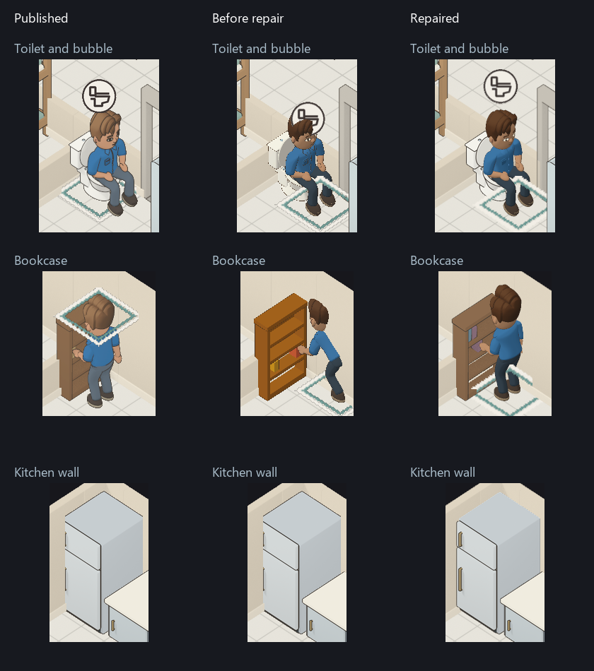

# Creator and rendering repair verification

The repaired local build is ready for owner review at `http://127.0.0.1:5190/`. Work remains local on `twcx/character-appearance-proof`; no publication or release is authorized. The reported trait warning, severe chair obstruction, preview spacing, interaction artwork, depth, bubble, and creator-flow defects are repaired and verified in the scoped evidence below. Owner artwork approval remains separate.

## Why acceptance was reopened

The earlier completion claim exceeded its evidence. Source hashes and isolated character proofs did not establish that fixtures retained their artwork during interactions, that every annotation cleared walls and heads, or that the full creator worked well as a player interface. The previous report retains its receipts and withdraws that readiness conclusion.

The repair keeps published fixture artwork independently owned, supplies registered source-surface depth, draws configured characters directly into a shared twice-display-resolution scene, and resolves color after visibility. Explicit outline metadata replaces inferred decorative outlines. Activity symbols now use a separate annotation-owner attachment, preserving physical depth and picking beneath them.

## Actual comparisons and independent review

1. [Matched-camera comparison](comparison/README.md): published revision `04160fe215fb8238e8b9aaff2f8493e7ff6a20d4`, the preserved before build, and the repaired worktree. Isolated storage, flat lighting, identical fixture camera positions, and the actual household expose the toilet, bookcase, bubble, and kitchen-wall differences.
2. [Creator review](final-creator-review/review.md): first-load and first-click randomization, locks, exact legacy preservation, category averages, reset boundaries, cancellation, autoplay, narrow navigation, preview stability, graphics recovery, and resource cleanup. The reviewer inspected all 24 reading views across both genders, body endpoints, and four facings.
3. [Gameplay review](final-game-review/review.md): interaction transitions, source furniture colors, cleaning approaches, shared furniture, picked identities, day/night lighting, and fractional zoom. The final pass verifies all 16 table-setting/rotation combinations and 12 reclining cases, including both genders with large wave hair, facial features, and glasses.
4. [Fresh source review](final-source-review.md): annotation ranges and ownership, physical attachment preservation, asynchronous picking, resource lifetime, recline caching, and head-envelope parity. This was a separate source inspection; it did not substitute for playing and inspecting the game.
5. [Fresh sleeping review](sleep-contact-compilation/adversarial-play-01/README.md): both bed models in all four facings, first use, shared occupancy, leaving, and returning. The reviewer inspected actual captures and verified unchanged cover resources, preparation counters, save bytes, and creator state through graphics recovery.
6. [Built-game delivery check](local-delivery/README.md): actual creator controls, the single trait-limit notice, measured preview spacing, creation of a fourth person, and exact save reload on the final local build.
7. [Chair review prevention follow-up](../2026-10-14-visual-review/README.md): the exact old anchor fails the independent camera check, and a fresh reviewer rejects deliberately faulty screenshots before learning their identity. Current poses and actual Reading playback are inspected separately. Project instructions now require this evidence for reproducible visual regressions.

## Specific repairs proved during review

1. The severe creator-chair intersection came from applying the game's half-tile anchor offset twice. Independent source-camera projection checks and actual four-facing views now agree. The owner-approved minor chair overlaps and body ranges remain unchanged.
2. The repeated trait warning is now one group-level message, shown only at the limit. Preview labels, buttons, facing text, and the small preview have stable spacing. Height explains its normalized control and displays the actual percentage in Review.
3. Occupied fixtures keep their original colors and outlines. Only declared moving parts change. The source geometry and published sprite data remain protected by hash checks.
4. Removing fixture pixels no longer removes mattress or saddle geometry required by pose fitting. The prior bunk render-loop exception has a geometry regression test and an actual saved-game replay.
5. Generated open bed fabric no longer receives a closed-solid inflated outline. The exact saved defect has 85 dark subpixels before the repair, zero after, 85 with the isolated fault restored, and zero after restoration.
6. Reclining keeps full body dimensions while fitting the torso and heels to the sofa and articulating the knees and neck. Independent checks cover 64 body corners, 36 clothing combinations, and 72 hair/face selections. The larger wave case uses approximately a 44.7-degree neck turn; the final reviewer inspected its appearance in all four facings.
7. The formerly clipped bubble now matches all 3,464 isolated reference samples in the actual scene and clears the measured head pixels by 5 pixels at that capture's scale. At the separately recorded former anchor, restoring the old physical-depth path loses 1,714 covered color samples. The current-pose mutation survival is retained honestly in the review; pose correction had removed that particular trigger.
8. Finished meals preserve the exact validated diner/table setting before ownership teardown. The pre-fix native test reproduced setting 1 becoming setting 0. The repaired game deposits and picks the correct dish at every tested setting and rotation.
9. Dropped books retain exact published color pixels and registration. Their missing historical scene required rigid reconstructed companion depth. The [asset report](dropped-book-review/README.md) distinguishes that reconstruction from recovery of the original surfaces.
10. Changing activities retains the configured body resources. Required bike and sleeping support is prepared before configuration admission; bed fixtures retain their cover buffers across occupancy changes. The final [178-scene attachment comparison](prepared-parity/README.md) preserves exact color, depth, and both identity attachments. The separately recorded bike reference-phase correction retains its measured raw differences and exact displayed-image comparison.

## Creator and mechanics contract

The creator uses Identity, Appearance, Personality, Needs & habits, Interests & skills, Household, and Review. Appearance groups start collapsed; clothing colors follow their matching selectors, Bald belongs to hairstyle selection, and freckle density appears only when enabled. Personality edits do not rebuild appearance. The preview plays Standing, Walking, Reading, and Cleaning independently of the paused household.

New drafts randomize supported values with their own generator. Gender is resolved before an unlocked name from the tagged 40/40/20 editorial pool. Field and section randomization respect locks, and undo restores both values and the draft generator. Existing characters preload exact records, including hidden legacy values. Review presents named traits and hobbies, deliberate units, and skill progress.

Cleanliness applies the agreed tolerance curve to individual dirty floor tiles, surfaces, and normalized dish load before room averaging. Autonomous chores use the same thresholds while retaining urgent needs, explicit orders, daily decisions, ownership, and random consumption. Skill copy describes actual practice and trait-related mishaps without promising faster activities.

Maintained documentation includes the creator contract, name rules, cleanliness specification, editing guarantees, activity-annotation and rendering contracts, player-visible string inventory, and prevention rules in lessons learned.

## Verification receipts

| Check | Result | Evidence |
| --- | --- | --- |
| Native workspace before the new dining repair | PASS, exit 0: 2,089 tests; one private-save example intentionally ignored | [command and totals](integration/native-workspace.json) |
| Dining regression and related lifecycle | Expected red, then PASS: 128 focused tests | [native report](dining-native/README.md) |
| Python bundle and bob checks | PASS, exit 0: six tests | [log](integration/python-tests.log) |
| Companion asset integrity | PASS, exit 0; source hashes, coverage, registration, and exact preserved colors | [log](integration/assets-final.log) |
| Shared shader/pipeline gate with annotations | PASS, exit 0: 60 valid pipelines, expected unsupported texture-count rejections, five rejected faults | [receipt](shader-annotations/receipt.json) |
| Shared physical-scene GPU contracts | PASS, exit 0: eleven checks and eight rejected faults | [report](gpu-contracts/README.md) |
| Annotation GPU contracts | PASS, exit 0: twelve checks and four rejected faults | [report](annotation-contracts/README.md) |
| Creator draft faults in isolated source | PASS, exit 0: four rejected faults and exact restoration | [report](draft-mutations/README.md) |
| Recline geometry and isolated faults | PASS; support, wall clearance, body dimensions, selectors, and five rejected faults | [report](recline-wall/README.md) |
| Native command memory and serialization | PASS: 30 focused runtime tests; library and affected test-target Clippy pass | [report](dining-native/command-memory/README.md) |
| Final WebAssembly build and historical save replay | PASS, exit 0; queued and completed pre-change saves reproduce byte for byte | [build log](integration/wasm-final.log), [replay receipt](integration/wasm-final-save-replay.json) |
| Bike support search equivalence | PASS: original deadlines retained; complete outputs match at 1,024 phases | [report](bike-fit-equivalence/README.md) |
| Web sweep, corrected failures, and final integration | Original sweep: 3,051 passed, nine failed; all failures corrected and passing in final 122-test integration run | [commands and receipts](integration/web-verification.md) |
| Final type checking and build | PASS, exit 0; warnings retained | [commands and receipts](integration/web-verification.md) |
| Prepared body and sleeping geometry | PASS; exact surface, pose, cover, queue, and protocol checks | [math report](sleep-contact-compilation/README.md), [integration report](sleep-contact-compilation/integration.md) |
| Final rendered attachment equality | PASS, exit 0: 178 cases, zero mismatches or browser errors | [receipt](prepared-parity/sleep-prepared/receipt.json) |
| Frame timing mutations | PASS: two faults rejected, exact restoration, production untouched | [report](measurement-v2/README.md) |
| Desktop frame times and allocations | Built game: combined 95th percentile 12.18 ms; four of 1,797 samples exceed 16.6 ms, maximum 26.125 ms | [hardware, cold costs, slow frames, and allocations](performance/README.md) |
| Built creator and save reload | PASS, exit 0: seven checks, no browser or graphics errors | [report](local-delivery/README.md) |

## Evidence boundaries

The review covers representative complete interaction transitions in every supported fixture facing and the documented body/appearance cases. It is not an exhaustive visual proof of every continuous slider combination. Floor mopping currently has one fixed worker facing in the simulation; four camera views would not prove four supported worker directions.

The private-save example requires an explicitly supplied private file and was intentionally skipped. Phone performance has not been measured on an authorized device. No owner artwork approval, publication, or release is claimed.

The final performance result covers sustained desktop play with six visible characters and two animated previews. Cold startup and configuration are slower and are reported separately; the result does not promise a 16.6 ms bound for loading, every frame, every continuous appearance combination, or weaker hardware. The full web sweep's initial failures remain visible alongside their successful repairs.
