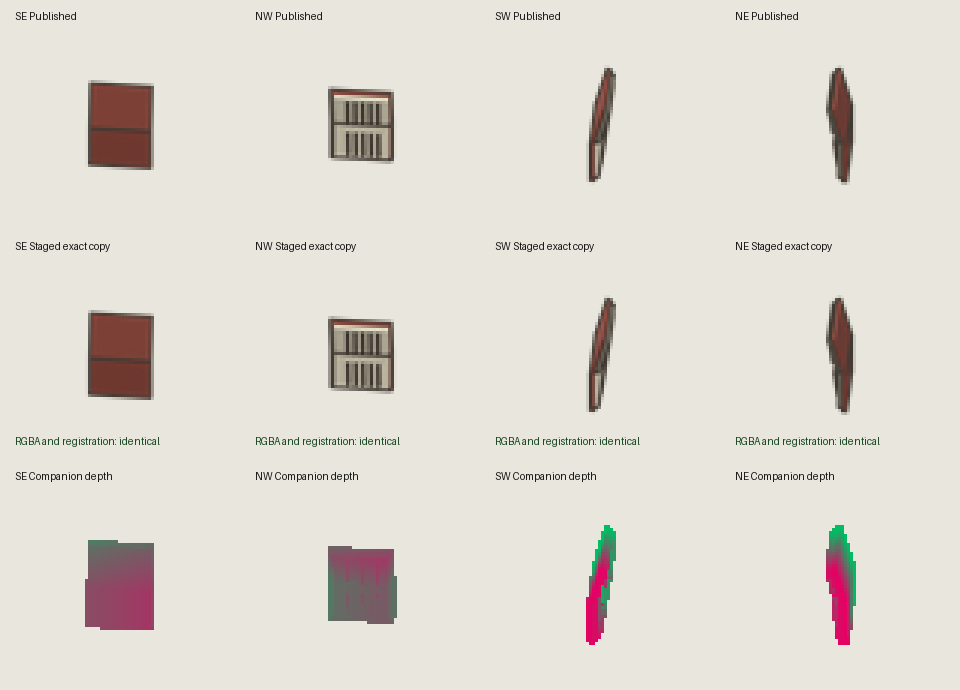

# Dropped-book color preservation

The staged companion preserves every published RGBA byte and the original registration in all four facings. The depth comes from a rigid reconstruction using all 14 retained canonical book parts at scale one. The original dropped-book authoring scene has not been recovered, so this does not establish exact recovery of its surfaces.

The output is staged in `.scratch/book-preservation/dropped-book`. No published atlas or live dropped-book bundle was changed by this work. The root task controls promotion after the browser reviewers finish using the frozen game.

## Fitting and physical support

The previous exporter optimized projected bounding-box sizes and chose yaw 233 degrees. That objective could select the wrong narrow-facing silhouette. The revised fitter compares complete registered alpha masks jointly across SE, NW, SW, and NE. It changes only in-plane yaw. It does not fit scale, translation, floor height, part geometry, or depth bias.

The retained source has a four-source-pixel Freestyle stroke and a four-to-one reduction. Its half-stroke is therefore 0.5 export pixels. A fixed stroke rasterization followed by Lanczos3 produces a yaw of 218.8 degrees, with summed absolute normalized alpha difference 97.2470588; the former yaw produces 337.4039216 under the same objective. This raster mask is a fitting approximation, not a claim to reproduce the unavailable source renderer. The earlier exploratory 220.4-degree fit used a one-source-pixel radius instead of the retained two-source-pixel half-stroke.

The published cropped PNG is copied, without recoloring or resizing, into its original 192 by 240 canvas at `rawCrop`. The existing logical `anchorOffset` remains `rawCrop / 2`. Depth samples trace the same covered color pixels against the rigid geometry. A covered point outside projected geometry inherits the nearest authored edge's physical depth. Its allowed distance derives from the retained half-stroke, Lanczos3 radius, and pixel-center radius: `0.5 + 3 + sqrt(0.5) = 4.2071068` export pixels. No padding surface or facing-dependent bias is introduced.

| Facing | Nonzero-alpha pixels | Maximum distance to geometry | Published RGBA and atlas | Registration and depth coverage |
| --- | ---: | ---: | --- | --- |
| SE | 660 | 1.339709 px | Exact | Exact |
| NW | 559 | 1.480581 px | Exact | Exact |
| SW | 248 | 1.555295 px | Exact | Exact |
| NE | 293 | 1.456700 px | Exact | Exact |

Reopening the saved model independently found exactly the 14 canonical book meshes, identical materials and ordered triangle indices, and a maximum pairwise vertex-distance error of `7.6134722e-8` world units. All four facings have minimum floor gap `0.0004999936`, support-triangle area approximately `0.001799997`, and zero vertices below the floor. See [the physical check](physical-verification.json).

## Checks

All commands ran from `D:/VIBES/.worktrees/5637/terrilives` with existing dependencies. The Blender scripts ran through the installed hidden launcher with `--background --threads 2 --disable-autoexec --python-exit-code 1`.

1. PASS, exit 0: `python -m py_compile assets/models/sims/character-repair/export_dropped_book.py assets/models/sims/character-repair/fit_dropped_book.py assets/models/sims/character-repair/verify_assets.py`.
2. PASS: hidden Blender launched `assets/models/sims/character-repair/export_dropped_book.py -- --output D:/VIBES/.worktrees/5637/terrilives/.scratch/book-preservation/dropped-book`. The newly written manifest reports `state: complete`, `background: true`, Blender `4.5.14 LTS`, and two threads. The detached launcher's return is not a Blender process-exit observation. The manifest and every declared output were checked afterward.
3. PASS, exit 0: `python assets/models/sims/character-repair/verify_assets.py --dropped-book-only --dropped-book-folder .scratch/book-preservation/dropped-book --output docs/evidence/2026-10-13-creator-repair/dropped-book-review/verification.json`. It checks exact PNG and atlas bytes, all four complete canvases, registration, matching depth coverage, source and producer hashes, and physical-report bounds. See [the results](verification.json).
4. PASS, exit 0: `python docs/evidence/2026-10-13-creator-repair/dropped-book-review/negative_controls.py`. All seven deliberate faults were rejected: changed color byte, missing depth coverage, shifted registration, replacement-color flag, changed source hash, changed scale, and unsupported floor gap. Mutations existed only in memory. See [the controls](negative-controls.json).
5. PASS: hidden Blender launched `docs/evidence/2026-10-13-creator-repair/dropped-book-review/verify_model.py`. Its newly written complete result confirms background execution and independently measures the reopened saved geometry in all facings against the canonical source. The launcher does not provide the detached Blender exit code.
6. PASS, exit 0: `python docs/evidence/2026-10-13-creator-repair/dropped-book-review/make_review.py`. The displayed contact sheet was inspected. The first two rows show the original pixels and the staged exact copy; the last row visualizes physical depth.

The [captured bundle manifest](bundle-manifest.json) retains source, producer, geometry, fit, model, and page hashes. The [fit result](fit-result.json) retains the search candidates and per-facing errors. The canonical source hash is `919e8994cbf7510a4d9947f173abec8b41ac77d61f6e829bcf5981c8d2fcddce`; the unavailable original scene hash remains `5bda1d0a696babbea3e30ed71137deb9942230a9f9226649db14586d00101fb9`.

Actual browser rendering after promotion remains a separate check. These asset checks do not establish the missing historical surface depths or owner visual acceptance.
