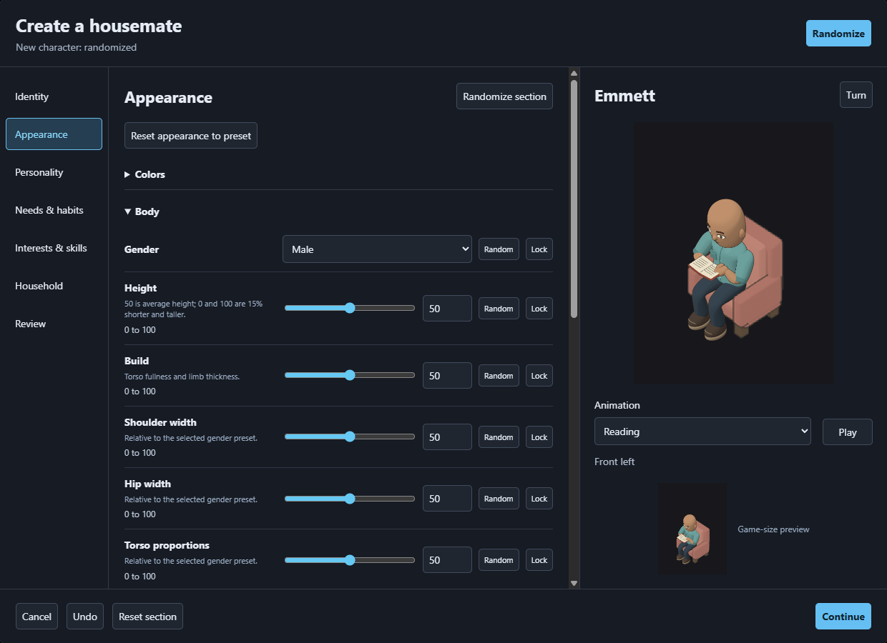
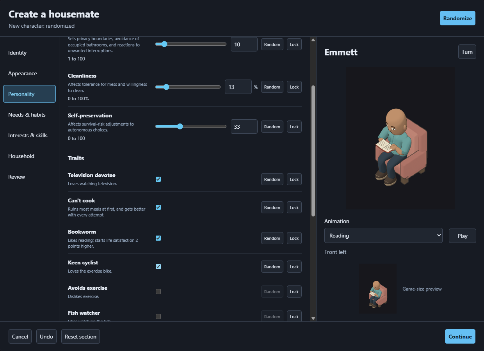

# Final local build check

The final built game passes the actual creator and save-reload check at `http://127.0.0.1:5190/`. The check uses fresh browser storage and muted Chrome, then closes its browser in `finally`. It does not change an owner save or publish the build.

```powershell
$env:DELIVERY_RUN='built-pass'
node scripts/character-creator-repair/check-local-delivery.cjs
```

Result: PASS, exit 0, seven assertions, no application or graphics errors. [The receipt](built-pass/report.json) records the built JavaScript, worker, and WebAssembly hashes, the resulting save hash, and each assertion.

1. Actual controls create a Male, bald, neutral-body Reading preview named Emmett. Both gaps around the preview controls measure 20 pixels.
2. Selecting four traits creates one group-level notice and no repeated warning in individual field descriptions. Selected traits remain selected; unavailable additions are disabled.
3. The unapplied draft preserves the complete live save. Applying it creates the fourth household member. Reloading the resulting bytes through required preparation reproduces the save exactly.
4. The large and small Reading previews, trait rows, and created household were inspected from the screenshots below. The chair no longer crosses the upper torso as in the rejected image, and the animation controls have visible separation from both previews.





The first capture attempt failed because its automation selected the stored gender identifier as an HTML option value. The control uses encoded values; selecting the visible Male and Bald labels matches the actual interface. `failure.json`, `failure.png`, and `../integration/local-delivery.log` preserve that harness error. No application error occurred, and no production change was needed. The passing rerun has its own directory.

Broader four-facing, body-range, lifecycle, mechanics, and performance evidence belongs to the [parent report](../README.md). These screenshots and checks support owner review; they do not replace it.
