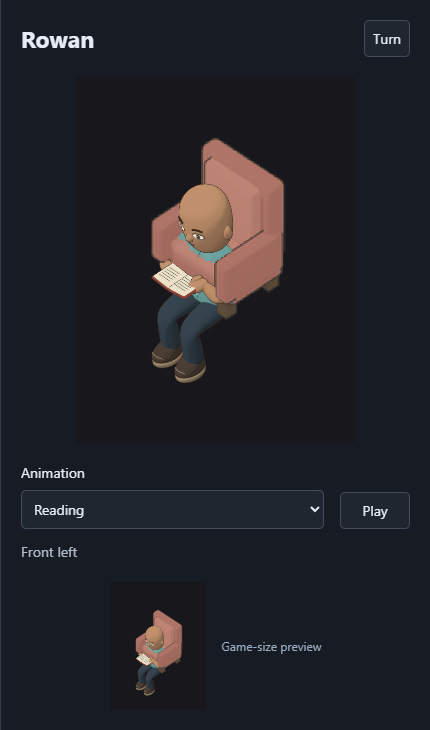
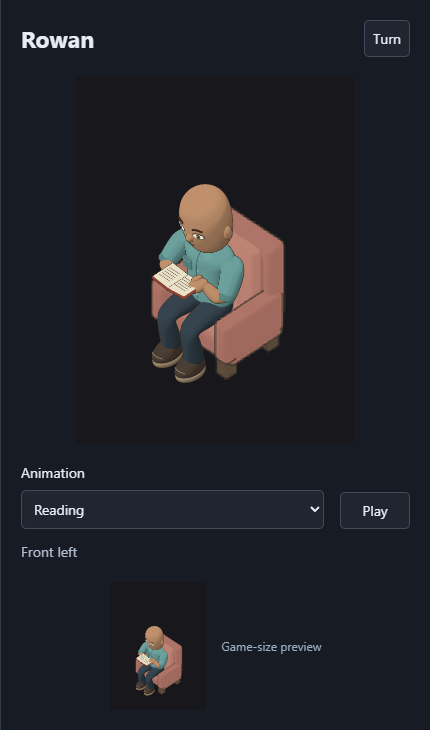

# Chair repair and visual-review prevention

The chair-placement correction was already present when this follow-up began. This work verifies that correction against the known failure and strengthens the review requirements. It does not alter the character's body ranges, accepted minor furniture overlap, or production artwork.

The earlier visual review missed a severe obstruction visible in its own browser window. Opening the game, creating screenshots, and passing functional checks did not establish that the displayed pose had been inspected. The owner identified the defect. The technical cause was a display-anchor offset applied again when registering the preview's chair against the physical character.

## Regression check

`node scripts/character-creator-repair/check-chair-registration.cjs` runs the actual preview-fixture tests with one worker and a 4 GiB heap limit. An isolated source transform restores the old anchor without writing production files. The baseline passes, the old anchor fails, and the restored transform passes. Each run records its command, exit status, source identity, and failure output.

The first run, [registration-01](registration-01/receipt.json), fails on a copied numeric anchor expectation by 20.999997973442078 logical pixels. That expectation was redundant and could encourage another test to repeat the renderer's placement number. The follow-up removes both copied X/Y anchor expectations and retains the stronger independent assertion: project 1,520 authored chair vertices through the recorded source camera, then compare their placement with the actual uploaded uniform across all four facings and both preview scales.

The current [registration-02 receipt](registration-02/receipt.json) records baseline exit 0 with four passing tests, old-anchor exit 1 with the expected registration failure, and restored exit 0 with four passing tests. The independent camera equality fails with `20.999999516069217` where it requires less than `0.0001`; no tolerance changed. Test, source-camera, and manifest hashes remain unchanged during the run. The production renderer is never edited by the fault check.

## Actual browser captures

`node scripts/character-creator-repair/capture-chair-review.cjs` exits 0 and records 29 captures with no browser errors. [The receipt](visual-01/report.json) includes the actual observed application-module URLs, body parameters, facing, frame, graphics uploads, image hashes, source hashes, and exact unchanged household bytes. It closes the isolated muted Chrome window in `finally`.

The capture's PASS status establishes capture validity and mechanical assertions only. Visual judgment is recorded separately below and by the independent reviewer.

1. `set-a-0.png` through `set-a-3.png` deliberately restore the old chair offset inside the isolated browser. The front views place chair arms across the chest and hide the shirt torso; the rear views raise the chair back toward the head. The thumbnails show the same defect.
2. `set-b-0.png` through `set-b-3.png` use the corrected renderer with otherwise identical settings. The chest, shoulders, hands, and book remain clear of the raised obstruction. Rear views hide the lower torso behind the chair's ordinary silhouette. `restored.png` is byte-identical to `set-b-0.png` after the fault is removed.
3. The coordinating agent and fresh reviewer each opened all 20 additional captures: Male at all body controls 0 and 100, and Female at 0, 50, and 100, in all four facings. Combined with group B, these cover 24 corrected configurations. No return of the severe torso obstruction was seen. Specifically accepted minor body/furniture contact remains accepted.
4. Both preview sizes appear in every capture. The Animation label, selector, Play button, facing text, and game-size preview have separate readable spaces. The full creator capture retains the surrounding navigation and controls.

The original screenshot's exact slider values were not available. These captures reproduce the faulty registration mechanism with a bald male body and compare matching settings; they do not claim to recover the original draft. The paused captures use Reading frame zero. They do not prove every interpolated animation frame, every combination of sliders, or screen-reader accessibility.

## Reading playback

The reviewer separately operated Play/Pause in isolated Chrome for both genders and all four facings. Each run observed a complete 4.8-second Reading loop without seeking frames or modifying the clock. All four authored sample bins appeared in successful draws. The reviewer opened all 24 representative playback images; the coordinating agent also opened the eight middle samples covering both genders and every facing. Neither inspection found the severe upper-torso obstruction, a detached book, or a new visible obstruction in those images.

[The playback report](autoplay-01/review.md) records the command, actual observed frame ranges, screenshot names, unchanged source/save hashes, and browser cleanup. These are representative frames from observed complete loops, not a claim to have visually inspected every interpolated frame. Household entry/exit and arbitrary mixed body controls remain covered only to the extent stated in the earlier broader repair evidence.

### Deliberately restored defect

### Corrected placement

## Review changes

[AGENTS.md](../../../AGENTS.md) now requires the visual evidence procedure in [Testing Protocol section 9](../../testing-protocol.md#9-every-milestone-ends-with-a-played-visual-pass) for rendering, animation, asset, and layout changes. The procedure requires actual image inspection by both the coordinator and a fresh reviewer, recorded filenames and findings, matching source/state identity, separate animation checks, and rejection of a known defective comparison before acceptance. A reviewer who accepts the defective control cannot approve the repair.

The fresh reviewer received groups A and B without their mapping and rejected A before the mapping was disclosed. The reviewer then inspected the remaining current body/facing captures. This validates detection of this known visual failure; it does not establish that every possible future defect will be noticed.

[The independent review](visual-01/independent-review.md) preserves that verdict separately from the capture script's assertions. Documentation-ID validation, script syntax checks, and scoped whitespace checks also pass. The current production renderer, application entry point, and native WebAssembly bytes match the previously measured local build; its built JavaScript and worker hashes also match. No application rebuild is needed for this test-and-review follow-up.

The corresponding lesson records the missed image, the insufficient visual inspection, the independent camera assertion, and the prevention procedure. No production-renderer changes, dependency changes, publication, or edits to owner browser storage occur in this follow-up. The previous [repair report](../2026-10-13-creator-repair/README.md) retains broader gameplay, mechanics, save, and performance evidence.
