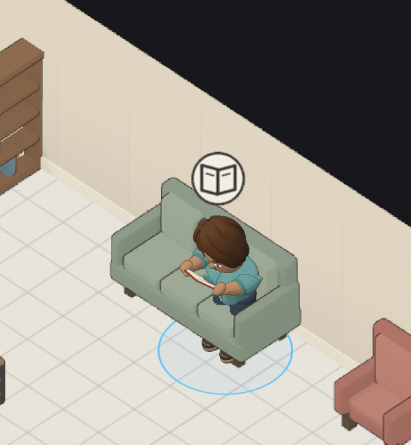
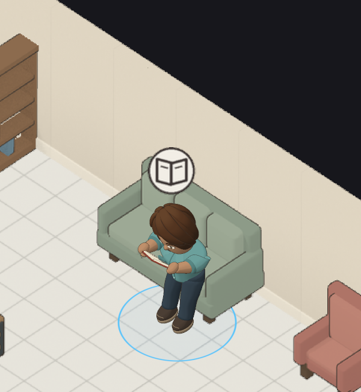
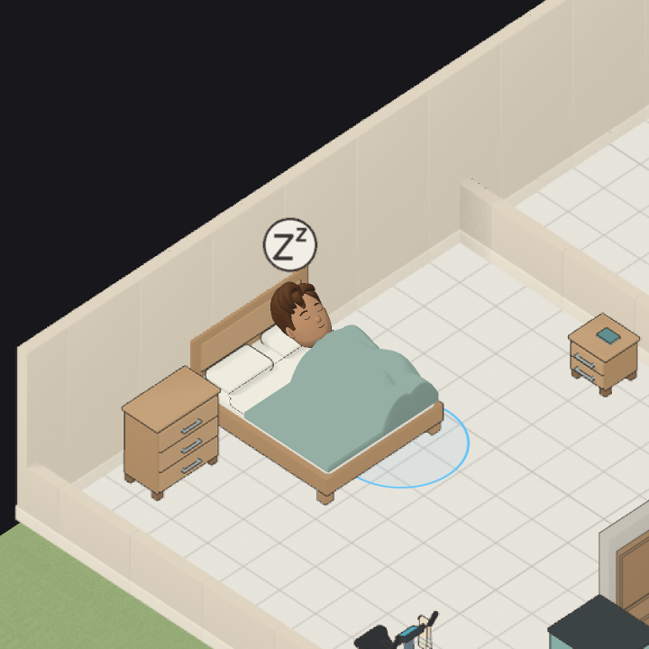

# Seating, selection, kitchen walls, and shower repair

Local verification on October 15, 2026. Baseline: `bb5ba9cde8be565a2800d25a87696f3e33ee9346`, fetched before repairs and refreshed before delivery. Tested working-tree source bindings are in [source-hashes.json](source-hashes.json); [staged-source-hashes.json](staged-source-hashes.json) verifies the Git blobs, including ordinary text normalization. Hash-bound asset inputs remain byte-exact. The work preserves accepted character source models, production sprites, saved characters, body ranges, and specifically accepted minor contact overlap.

## Visible repairs

1. Seated poses jointly fit a connected pelvis support patch, grounded feet, and calf clearance against actual furniture. Dining also solves the rigid hand and spoon around the existing bowl target. Stable sofa places follow their visible cushions. Required fits run in the existing background preparation worker, with no synchronous production fitting fallback.
2. The selected person has a smooth blue floor ellipse. Its 1.95-logical-pixel border is 1.5 times the original 1.3-pixel proposal, a 50% increase. Fill alpha rises from 0.065 to 0.105. The color-only pass tests scene depth and writes neither depth nor identity. Placement tiles keep their separate square marker behavior.
3. Kitchen artwork, physical depth, contents, overlays, and contacting characters share a wall-aware translation derived from source geometry. Adjacent wall thickness and clearance determine placement. Accepted source geometry is unchanged.
4. Showering has a nominal duration of 90 simulation ticks rather than 45. Existing duration variation samples 54 to 126 ticks; one tick is one game minute. Shared washing animation moves the upper body while feet remain planted. A scene-lit translucent volume veils the chest and pelvis and respects opaque enclosure panels.
5. Correspondence reports its visible chair separately from the desk used by gameplay. Standing work still reports no chair. A native test reproduced the missing chair record before the whitelist correction.
6. Head-envelope preparation now stores numeric scan data and compares exact head-matrix dependencies. It retains Float64 coefficients (the original JavaScript 64-bit precision), accumulation order, normal adjacency, visibility rules, and winner order. This reduces repeated bubble-placement work without approximating the head or changing its geometry.

## Selected actual game images

The sofa pair uses the same feminine body settings: height 0, build 100, shoulders 100, hips 0, torso 100; animation sample 3.4445. The earlier candidate visibly buried the lower legs. These are browser renders, not concept artwork.

| Rejected candidate | Repaired candidate |
| --- | --- |
|  |  |
|  |  |

The bed comparison demonstrates floor visibility; it is not a matched body-parameter comparison. [Image provenance](image-provenance.json) records source filenames and hashes. [Shower quarters](shower-after.png) and [kitchen wall clearance](kitchen-after.png) show additional repaired states. Full temporary matrices remain in ignored local scratch storage; no videos, animated GIFs, or trace archives are included.

## Actual gameplay and independent review

1. Native entry, active, and exit capture covered 13 seat/reading/reclining combinations in all four facings. Enlarged captures cover the same 52 cases. Dining covers all 16 table-facing and setting combinations, including resulting dishes. Shared three-person sofas, seated TV, radio, and correspondence cover all four facings.
2. An independent reviewer inspected all 52 enlarged seat images, 48 dining images, 36 shared-sofa/media images, and 12 correspondence images. The reviewer also ran 17 continuous native seating cycles at 1x and inspected a meal exit. Earlier defective sofa and blanket-marker images were rejected before repaired-image acceptance. See [seat images](independent-seat-images.json), [played seating](independent-seat-play.json), [media and shared seats](independent-context-images.json), and [correspondence](independent-correspondence-images.json).
3. A fresh shower reviewer inspected 72 static phases and 192 samples from eight complete native 1x activities, covering both gender/body extremes and four facings. All 16 animation bins occurred. Pause preserved pixels, clock, and pose; exits restored clothing and removed vapor. Each sampled activity lasted 54 ticks, within the specified variation. See [shower review](independent-shower-review.json).
4. The implementer separately inspected required facings, the triggering sofa configuration, dining settings, normal-size shower phases, and final creator/loading captures. [Inspection record](root-image-inspection.json) lists the main matrices. Source/specification reviewers found no unresolved issue, including the later correspondence and head-envelope changes.
5. Creator checks exercised repeated height edits, reading previews, cancellation, resource release, name/personality edits without appearance preparation, and graphics recovery with an unsaved name and lock. Native save bytes remained exact on cancellation. A 600-by-900 flow verified initial traits, the first Randomize click, locks, default Walking, collapsed Appearance groups, and creation with the preview hidden. Final built delivery checks also exercised loading before scripts, reset to 1.0x, undo, spacing, trait-limit messaging, creation, and exact reload. See [lifecycle](creator-lifecycle.json), [narrow flow](creator-narrow.json), and [built delivery](local-delivery.json).

A final fresh reviewer then inspected the final built loading/creator/game images, two simulation activities through exit, selected-person markers, and running Walking/Reading creator previews followed by Cancel. The reviewer found no new actionable defect; only a missing favicon was reproduced in follow-up resource diagnostics. See [final visual review](final-visual-review.json).

These reviews inspect recorded moments alongside native continuous playback; they do not claim that every intermediate pixel was personally watched. The rear shower facing demonstrates solid-panel occlusion, not an exposed-body view. Continuous nighttime shower playback, phone performance, and a full conversation/household need-cycle audit are outside this focused repair pass. Previously accepted small chair/body contact remains accepted; the new buried-leg defect was repaired.

## Desktop measurements

The central processing unit (CPU) runs the synchronous frame work measured here. Rendering runs on the graphics processing unit (GPU); completion timings also include browser scheduling. The p95 and p99 columns are the 95th and 99th percentiles.

Displayed Chrome 155.0.8059.85, 2400 by 1200, Intel Core i7-13700KF, NVIDIA RTX 4090, driver 32.0.16.1656, 64GB memory. Each final window lasted 15 seconds with six actual characters, a 608-by-800 animated reading preview, and a 96-by-128 preview. Pixel picking established all six people before and after measurement. The view stayed focused and visible; actor counts stayed six, source hashes stayed fixed, and no preparation ran during the warm windows.

| Final workload | CPU frame p95 / max | Scene plus preview completion p95 / p99 / max | Completion samples over 16.6ms |
| --- | --- | --- | --- |
| Paused world, animated previews | 2.5 / 14.5ms | 8.6 / 9.9 / 18.5ms | 1 of 900 |
| Native 1x gameplay, animated previews | 8.3 / 11.0ms | 13.2 / 14.8 / 28.2ms | 2 of 899 |

The moving scene advances from tick 130 to 280 and includes ordinary action transitions and brief shower completion gaps. It is not a claim of uninterrupted steam or six identical poses throughout. The paused scene retains six simultaneous active fixture poses, including the shower. Queue completion includes browser scheduling; it is not an isolated GPU execution measurement.

The earlier moving candidate missed the target: completion p95 was 27.8ms, maximum 34.5ms, with 119 of 819 samples over budget. An exact dependency cache alone did not solve it. Profiled CPU samples identified head-envelope scans as the dominant cost; prepared numeric loops produced the final results above. The separate diagnostic profiling run is not substituted for unprofiled acceptance.

Cold configuration remains slower than the frame target. The 30-second post-startup window includes fresh-household admission, three new characters, and first preview preparation. Final cold CPU maxima were 799.6ms for the static setup and 543.5ms for the moving setup; total latency maxima were 869.1ms and 599.0ms. First preview preparation took 347.4ms and 276.9ms. These costs are retained in [performance.json](performance.json), not excluded by calling every frame smooth.

End-of-window JavaScript heap was 507.2MB static and 552.8MB moving; WebAssembly memory was about 2.5MB. Explicit GPU buffers were 205.4MB; textures were estimated at 1,328.2MB. Texture estimates exclude driver padding, staging, and swapchains. These are end snapshots, not peak process or driver memory. Prepared coefficient arrays add approximately 5.24MB across these six appearances, plus scan metadata. No phone performance is established.

To reproduce the measurements from the repository root, build and serve the game separately, then run the retained recipe with the server URL. Use one displayed browser and no concurrent heavy verification task:

```powershell
$env:GAME_URL='http://127.0.0.1:5200'
$env:RUN_LABEL='reproduce-moving'
$env:MEASURE_MS='15000'
$env:NORMAL_DRIVER='1'
$env:CPU_PROFILE=$null
node docs/evidence/2026-10-15-seating-selection-shower/measure-world.cjs
```

Unset `NORMAL_DRIVER` for the paused-world measurement. The recipe uses the already installed Playwright runtime and Chrome. It uses native orders and generated appearances with seeds 500 through 502; eight queued orders per person establish the simultaneous fixture state at tick 130. Failed placement and timing setups are retained in scratch and are not counted as performance runs.

## Executed local checks

| Command or group | Observed result |
| --- | --- |
| `cargo test --workspace -- --test-threads=1` | Core/data groups passed; simulation had 1,389 passes and two failures caused by assumptions about the former shower duration. Both were repaired and passed individually. The full command itself was not rerun or relabeled as passing. |
| `cargo test -p terri-sim washing_hands_stops_at_partial_hygiene_without_charging_comfort -- --test-threads=1` | Passed; wait derived from delivery rate, original hygiene and comfort assertions retained. |
| `cargo test -p terri-sim repeated_snacks_make_a_person_sick_and_decay_heals_them -- --test-threads=1` | Passed; independently predicted duration/decay threshold replaces incidental snack timing. |
| `cargo test -p terri-sim seating:: -- --test-threads=1` | 57 passed after the correspondence correction. |
| `cargo test -p terri-wasm -- --test-threads=1` | 274 tests passed; applicable documentation tests passed separately. |
| `cargo fmt --all -- --check`; `cargo clippy --workspace --all-targets -- -D warnings` | Passed after the final native change. |
| `npm --prefix web test -- --maxWorkers=1` | Initial full run: 3,342 passed and nine failed. The nine failures were repaired, including a real missing legacy-marker registration offset. |
| Focused frame, instance batch, marker, fixture, bed, fridge, and picking rerun | 160 passed. |
| Focused seated preparation, performance, admission, and prepared-character rerun | 97 passed. |
| Head-envelope reference and visibility suites | 39 passed; complete point bytes and exact projected tops compared. Final visibility rerun: 14 passed. |
| Focused physical seating/dining/place checks | Passed, including body corners and intermediate animation samples. |
| Python kitchen, kitchen actions, bathroom, bathroom actions | 15, 23, 8, and 128 passed. Exact commands and output are in [python-checks.json](python-checks.json). |
| `npm --prefix web run typecheck`; production Vite build | Passed after the final runtime changes. Existing large-chunk advisory remains. |
| `python check-doc-ids.py`; changelog tests and build | Passed; repeated before delivery after documentation edits. |
| `node scripts/character-creator-repair/check-local-delivery.cjs` against the final built server | 13 checks passed, no browser or graphics errors. |

Mutation checks deliberately disabled calf clearance, pelvis support, rigid utensil fitting, sofa place ordering, and marker depth visibility. Each corresponding assertion rejected the defect, and source restoration hashes matched. In the same-frame GPU marker test, disabling depth changed 139,341 bytes; restoring it changed zero bytes and reproduced the original image hash. See [mutation results](mutation-results.json) and [asset checks](asset-checks.json).

Existing unrelated sprite-generation suites and the full remote mutation sweep were not repeated for unchanged production sprite assets. Local targeted mutation checks are narrower than that remote sweep. Duplicate GitHub CI and review are skipped under the owner's explicit authorization; the deployment workflow remains required. No remote pending check is represented as passing.
